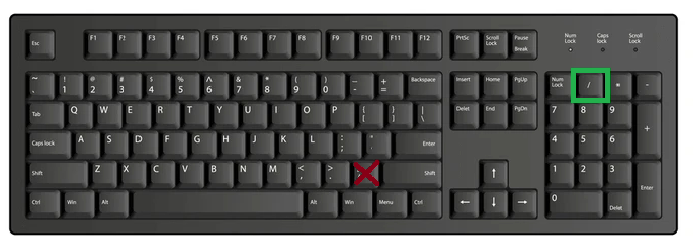

# SCUM MiniMap v1.7.23

Download the complete application from [the current release](https://github.com/Mike-Rafone-SCUM/MiniMap/releases/tag/v1.7.23). This repository contains the current buildable source; see [build instructions](DEVELOPMENT.md) and [source-release scope and checks](docs/SOURCE-RELEASE.md).

SCUM MiniMap is an external map overlay and navigation utility for SCUM, made for the Skynett community. It displays player location, heading, road routes, points of interest, and custom waypoints. It does not read game memory or inject DLLs; this is not an official anticheat certification.

Extract the complete release ZIP, keep its `assets` folder beside `SkynettMiniMap.exe`, then run the EXE and approve Windows' administrator prompt. Test and release executables request administrator rights at launch so their input can reach an elevated SCUM process. High-resolution map tiles and road networks are separate, checksum-verified data files; over 8,000 categorized ScumMap points of interest across 106 categories remain embedded. There are no separate startup map/road downloads.

The EXE alone is not a complete installation. The first upgrade from v1.7.14 or an earlier EXE-only release requires extracting the new ZIP and running `Update-MiniMap.cmd` from that folder. Later automatic updates download and verify the complete package. Missing or modified installation assets stop normal startup; reinstall the complete official ZIP to recover. Settings, zones and kits remain in AppData.

> [!IMPORTANT]
> SCUM must run in **Borderless Window** or **Windowed** mode. Windows exclusive fullscreen mode takes dedicated hardware control of the display and suppresses external desktop overlays.

> [!IMPORTANT]
> **COPY LOCATION: NUMPAD / IS THE DEFAULT. SCUM'S KEY MUST MATCH MINIMAP.**
> In SCUM Controls, bind **Copy Location** to **NumPad / (number-pad divide), without Ctrl, Shift or Alt**, and select the same key in MiniMap. Existing saved bindings are retained: if you use another key, it must match in both applications. Without a matching binding, automatic position tracking will not work.

MusicalScumbag users: update MusicalScumbag to the corrected build with **F10** auto-walk. Its older NumPad / auto-walk shortcut conflicts with MiniMap's automatic Copy Location presses.

---

## Official Distribution & Automatic Updates

### Admin command panel

A slim, 28-pixel **Admin** tab stays attached beside both the compact minimap and expanded map. Click its arrow or label to expand; **×**, Escape or native window closing collapse it back to the tab. The same controls retain their command sections and teleport choices between map modes, follow the map when it moves or resizes, and hide with the map or while commands are sent. The map keeps its original size and position. **Commands** and **Directional teleport** have their own expandable sections, using the map sidebar's colours, typography, buttons and scrolling. Settings, tray and map menu shortcuts expand the same panel.

Open the full map's **Admin commands** dropdown from its right-click menu or sidebar Tools section. Select a command, then **ON** or **OFF** to send `true` or `false` for God mode, player info or nameplates. The panel also offers a toggle button and explicit **ON**/**OFF** buttons. **Edit commands…** opens the editor to add, edit or remove commands; enter the base command without its final true/false argument. The editor is also accessible from Settings and the tray menu. Existing On/Off button pairs migrate into one command. Displayed values are the last submitted requests and start **UNKNOWN** each session; use **OFF** to disable an effect that is already active in SCUM. Check SCUM for the actual state.

The presets send `#SetGodMode true/false`, `#ShowOtherPlayerInfo true/false` and `#ShowNameplates true/false`. God mode is SCUM's blueprint building mode; the server must grant the relevant admin permission. The panel cannot read the live state or confirm that a command succeeded.

Open **Admin players** from the attached panel or admin menu. Enter a server name and click **Select server** before importing. **Refresh from game** automatically captures `#ListPlayers true`, `#ListSpawnedVehicles true`, `#DumpAllSquadsInfoList true`, then `#ListFlags 1 true` and every remaining flag page reported by SCUM. A server with two flag pages needs five commands regardless of its player or squad count. **Refresh all information** on a profile uses the same sequence. Each response is validated and imported before sending the next command. No server bridge is required. Always check the selected name matches the connected server when switching servers.

The directory saves character/platform names, IDs, coordinates, last-seen times and copied fame/bank/gold values in `%LocalAppData%\ScumMiniMap\admin-players.db`. These are read-only snapshots. New imports update that server's players by ID and retain missing players as history. Search either name or ID, then use **Teleport to player** or **Bring player here**; SCUM still requires the appropriate admin permission and an available target. Check the game for the result.

Players open as a searchable card directory, with **Overview**, **Vehicles**, **Flags** and **Squad** quick links. Cards use pages sized to the window, with **Previous**, **Next** and an editable page number. Scroll the mouse wheel over the list or a card to change pages: down for next, up for previous. Navigation stops at the first and last pages. Search and sorting start on the first page. **Table view** remains available. Each overview shows player identity, the population snapshot and copied statistics, with links to the asset pages and squad. Squad members link to their own profiles; imported members can have profiles before appearing in a population list.

After submitting a teleport from player tools, the directory and profiles stay hidden so you can see SCUM. Press **NumPad +** (number-pad add) to reopen Admin players with the same server, search and page. This shortcut is configurable or can be unbound in Settings and the rebinding wizard. If a command stops before submission, the tools retain their normal restoration behavior.

Use **Refresh vehicle list** for just the vehicles, or **Refresh squad and flags** for one bulk squad report and all flag pages. **Import clipboard** accepts player lists, bulk squad dumps, individual flag pages and the older `#SquadInfo <Platform ID>` report. The import button's context menu copies the bulk squad, vehicle and first flag-page commands. Squad membership, ranks, status, flags and vehicle observations live in the per-server `%LocalAppData%\ScumMiniMap\admin-profiles.db` SQLite database. The bulk squad dump does not report online status: a full refresh derives it from the fresh player list; a standalone dump import shows status as unreported. Vehicle lists match individual registrations using the reported `STEAMID:` tag, retaining legitimate multiple vehicles and the original ownership observations. Without a registration tag, flag reports can resolve offline database owner IDs when the association is unambiguous. Explicitly unowned vehicles and flags remain unowned.

In **Vehicles** or **Flags**, select one or more entries and choose **Show selected on map**. The player tools hide to reveal labeled snapshot markers; reopen Players to return. **Clear asset markers** removes that layer, and choosing another server clears it automatically. A new vehicle list replaces that server's vehicle snapshot; a bulk squad dump replaces its membership snapshot. Flags are replaced in one transaction only after all pages pass validation. A failed page leaves the previous complete flag list intact. Manual page imports merge into saved flags without deleting other pages. These remain snapshots rather than live tracking.

Enable **Show players on map** to draw the latest snapshot in both map modes. Labels show coordinate age; dots turn gray after 60 seconds and disappear after five minutes. Refresh again to update movement and population. Saved history remains available in the directory. This layer starts disabled and is cleared when choosing another server.

Choose **Directional teleport…** in the dropdown, or open the admin panel, to teleport from your latest received position. Select **Up**, **Down**, **Left**, **Right**, **Forward** or **Back**, enter a distance in metres (20 by default), review the command preview, then click **Send teleport**. Left/right/forward/back use your last recorded facing direction and keep the same elevation; up/down change only elevation. MiniMap converts metres to SCUM coordinate units and sends a clean `#Teleport X Y Z` command. The coordinate age is shown beside the source position. After submission, another step waits for a new coordinate reading from SCUM; the app keeps your actual recorded position until that reading arrives.

Close chat and inventory, then click the required button. MiniMap closes the dropdown before focusing SCUM, pauses location copying and shortcuts throughout command preparation, closes the expanded map when needed, opens chat using your configured physical chat key, pastes the displayed command, presses Enter, then sends Escape to dismiss chat. The sequence uses shorter delays and checks for held keys before starting. Avoid keyboard or mouse actions while it sends. Focus changes, physical input or another clipboard update stop further submission; if interrupted after chat opens, close SCUM chat before retrying. Once Enter is dispatched, the requested value is recorded even if Enter release or Escape cleanup is interrupted. Sends cancelled before Enter leave the last submitted value unchanged.

Open the **Commands** section and use **Add command**, **Edit** or **Remove** to manage your own single-line commands beginning with `#`. Buttons persist in `admin-commands.tsv` in your active user data folder. Location copying pauses during sending. The previous clipboard is restored only if no other application or action has replaced it.

Choose a **Command type** in the editor: **Run once / free-text arguments**, **Pill toggle: true / false**, **Pill toggle: 1 / 0**, or **Numeric value**. Enter a button label and the command beginning with `#`; use **Arguments (any text)** for additional single-line arguments, including quotes. Toggle previews show the exact ON and OFF commands. Clicking a toggle pill switches the last submitted request; explicit ON/OFF buttons also remain available. Numeric commands have an editable value on their card: change it, then click the command button to validate, save and send. Use a decimal point for values such as **0**, **0.5** or **1**, and use the range accepted by the particular SCUM command. Existing saved commands remain compatible. Cancel or Close discards unsaved editor changes and returns to the command controls.

### Item selector and spawn cart

Choose **Item spawner / cart…** in the admin dropdown or **Commands** section. The category tree groups weapons, clothing and armour, food/health/survival, equipment/crafting, vehicle parts and other items. Expand a group to browse SCUM Database categories and subcategories, such as assault rifles, pistols, food, medicine, tools or backpacks. Search by item name, spawn ID or subtype within the selected category, select several items and choose a quantity, then click **Add selected**. Double-click adds one selection. Each skin or variant retains its own ID. Edit quantities in the cart, remove individual entries, or clear it. The command preview shows exactly what will be sent. **Save kit…** stores a named loadout; **Load kit…** lets you select a saved kit and replaces the current cart after validating every ID, quantity and modifier. Named kits and the working cart are stored in the SQLite file `spawn-kits.db` under `%LocalAppData%\ScumMiniMap` (or `%LocalAppData%\ScumMiniMap-ResponsivenessTest` for test builds). An existing `spawn-cart.tsv` migrates once, retaining the original file. Use the kit list's import button to add old TSV kits to the database.

The catalogue is bundled from [SCUM Database](https://scum-db.com/) and works offline. It includes records marked as spawnable items and excludes hidden, removed and buildable-only records. Search `AK47`, `AK-47` or `AK 47` to see matching guns together with their source-listed magazines, ammunition and compatible attachments. Add a term such as `AK47 scope` to narrow the related parts. The **Related to** column identifies the matching weapons and marks parts that may need an adapter. Related parts can appear across categories when their matching gun belongs to the selected category; browsing without a search keeps the category's normal contents. See [the catalogue source notes](docs/SPAWN-ITEM-CATALOG.md) for snapshot details and refresh commands. Catalogue availability depends on the game's version and the server's admin permissions.

Results appear in collapsible sections using the source category and subtype: ammunition by calibre, magazines, scopes, sights, rails, suppressors and other item groups. Each section shows its item count. Use **Expand all** or **Collapse all**, or open individual sections; the window remembers their collapse state while you search. Collapsing a section clears its selected rows so hidden items cannot be added accidentally. Ctrl-click and Shift-click still select items across open sections. A selection count shows what **Add selected** will add. **Clear search** resets the query, and Ctrl+F focuses the search box. Names and compatibility appear before spawn IDs; hover a row for its full ID and compatibility details.

Select one or more cart rows and click **Edit modifiers…**. Use Ctrl-click for individual rows or Shift-click for a range. Check **Health**, **Uses**, **Dirtiness**, **Location**, **KeyCardSector**, **StackCount**, **Radiation** or **Weight**, then select a preset value from its dropdown. Choosing a value also checks that modifier; unchecking it restores the game's default. When editing several items, shared values appear normally and differing values show **Mixed**. Only modifiers you change apply to all selected items; untouched values stay as they were on each item. **Reset to defaults** clears all modifiers on the selected items. Every selected command is validated before the cart changes, and unselected items retain their values. Numeric dropdowns accept custom values, and **KeyCardSector** offers the sixteen supported sectors. Quantity controls how many items spawn; modifiers apply to each item. For **Location**, enter `X=100 Y=200 Z=300`, three coordinates, copied SCUM location text, or a 17-digit Steam ID; the editor adds the required quotes. Use a period for decimal values. The **Modifiers** column can also accept property/value pairs such as `Health 100 Uses 10 Weight 3.5` or `Location "X=100 Y=200 Z=300"`. The preview includes the resulting arguments, and kits save each item's modifiers. Imported older two-column TSV kits use default modifiers. SCUM enforces the individual item's maximum uses and stack size; see [modifier source notes](docs/SPAWN-MODIFIERS.md) for supported values.

Click **Send cart** once to submit each `#SpawnItem ID quantity` command beside your admin character. MiniMap limits each cart to 100 item types, 100 of each item and 1,000 total items. Keep SCUM focused and release held keys; pressing a key, switching windows or replacing the clipboard stops sending. Commands are sent in order with a 60 ms pause between them, in addition to the time allowed for opening chat, pasting and closing it. Once Enter is dispatched, that entry leaves the working cart, even if chat cleanup is interrupted. Unsent entries remain available to retry. Close SCUM chat before retrying after an interruption. The result reports commands submitted; check SCUM to confirm the items spawned.

The selector displays the configured SCUM chat key; it must match the game's Controls. MiniMap finishes the Send button's click event, validates any active quantity/modifier edit, then allows a short wait for SCUM to receive focus and for held keys to release. The cart publishes and verifies command text while holding the clipboard lock, then verifies ownership and text again after Windows adds its text formats on close. It retains the resulting stable sequence for ownership checks before paste. Brief clipboard contention can settle for up to 100 ms. MiniMap changes its map state only when the map-closing key is accepted, then allows up to 500 ms for the game's closing menu to disappear before opening chat. It sends the map toggle and each command once. Repeated screen-based inventory checks pause during the sender's own transitions. Physical input still stops submission. If no command is submitted, the footer shows **Not sent** with the blocking reason, including a native input error when Windows rejects a key. Cart click, validation, save, admin attempt, focus and submission diagnostics are written to `automatic.log` in the active data folder. `spawn-cart.log` beside the saved cart separately records click/preparation stages, submission counts and the stop gate. Neither log records commands or clipboard contents.

Official binaries, update manifests, and cryptographic checksums are distributed exclusively via GitHub Releases:

* **Official Repository:** [Mike-Rafone-SCUM/MiniMap](https://github.com/Mike-Rafone-SCUM/MiniMap)
* **Latest Release:** [GitHub Releases Latest](https://github.com/Mike-Rafone-SCUM/MiniMap/releases/latest)
* **Executable (requires matching assets):** [SkynettMiniMap.exe](https://github.com/Mike-Rafone-SCUM/MiniMap/releases/latest/download/SkynettMiniMap.exe)
* **Complete Archive:** [SkynettMiniMap.zip](https://github.com/Mike-Rafone-SCUM/MiniMap/releases/latest/download/SkynettMiniMap.zip)

### Integrated Auto-Updater
SCUM MiniMap checks the version in the official `update.txt` manifest at startup. Startup results are cached for up to an hour; manual checks through **Check for updates (GitHub)** in the tray menu or Settings reuse results for up to one minute. A newer release prompts you to update. After your confirmation, the complete ZIP package's SHA-256 checksum is verified. Its executable and map/road assets are extracted into private staging beside the installed executable, with per-file checksums, a fixed file allowlist and size limits.

After you accept an update, MiniMap verifies the download, closes automatically, replaces its executable and assets and restarts. The helper checks the exact process, executable path and start time before closing it; if that MiniMap does not exit normally, it uses a bounded force-close fallback. SCUM and other applications stay running. The helper verifies staging again, retains previous files until launch succeeds and restores them on replacement or launch failure. Cancelling an administrator prompt or failing verification leaves the previous app intact.

For the first upgrade from an EXE-only release such as v1.7.14, download and extract the complete **SkynettMiniMap.zip**, then run **Update-MiniMap.cmd** while the old MiniMap is running. Approve the Windows administrator prompt and accept the offer to update the existing installation. The launcher also supports selecting an installed executable. It verifies the new executable and assets before closing and replacing the old app. Keep your AppData folder; settings, zones, waypoints and kits are retained. Older automatic updaters cannot understand the new package manifest and reject it rather than install an incomplete EXE.

### Discord support

Join the [SCUM MiniMap Discord](https://discord.gg/MYzcGaFDMn) for downloads, release notices, guides, and support. Official information is in English; translation buttons provide private translations on demand. Localised community chats are also available. The app's language setting is separate from Discord.

---

## Copy-key setup



Keyboard illustration supplied by a member of the SCUM MiniMap Discord. The green box marks **NumPad /**; the red cross marks the main keyboard slash key. Bind SCUM's **Copy location** to the same key selected in MiniMap.

The default for new installations is **Num / (number-pad divide) without a modifier**. In SCUM controls, manually bind **Copy location** to that same key. MiniMap cannot change SCUM's controls. If your keyboard has no number pad, choose another unused single key in SCUM and capture it in MiniMap's setup guide or key wizard.

Existing saved bindings are preserved. When switching from Ctrl+C, select **Single key without modifier** in MiniMap as well. Single-key tracking supports a 250 ms interval without injecting Ctrl; Ctrl+C remains supported at a minimum one-second interval. Actual updates depend on SCUM supplying coordinates.

On ABNT2 and other non-US keyboards, use **Capture** beside Copy Location in MiniMap's key wizard: it saves the physical scan code of the key you press and sends that same key to SCUM. Map, Chat and every MiniMap shortcut also support physical-key capture. Existing saved bindings remain intact until you change them.

Open **SCUM and MiniMap key rebinding wizard** in Settings to configure all game bindings and app actions together. Match SCUM Map, Chat and Copy location to the game's controls; MiniMap cannot change those controls for you. The same configured SCUM Map key opens and closes both SCUM's map and MiniMap's expanded overlay. See [Controls & Keybinds](#controls--keybinds) for the complete app action list.

## Optional voice navigation (work in progress)

Voice navigation is **off by default**. Enable it in Settings, select **Lyan (Female US)**, **Mira (Russian)**, **Mila (German)** or **Isabel (Spanish Argentine)**, set the volume and use Preview voice. Each voice includes distance, direction, U-turn and arrival prompts. Russian and German distance cues play the distance followed by the action; Spanish uses “En” before the distance. Guidance includes distance/turn prompts, arrival and wrong-way handling. Accuracy and prompt timing are still being refined; check the map and road signs when following a route. Recalculation appears on screen; the bundled clips do not include spoken “recalculating”.

In Settings, **MiniMap shortcuts (single keys)** lets you capture or unbind every app action, including zoom, map visibility, waypoint tools and admin commands. The key rebinding wizard offers the same controls. Click an action and press a single physical key without Ctrl, Alt, Shift or Windows; Escape cancels capture. Duplicate shortcuts, reserved game/dialog controls and keys already used by SCUM Map, Chat or Copy location are rejected. For number-pad keys, keep Num Lock in the same state when capturing and using the key. Preferences are saved per user. If the default keys are unavailable, open Settings through the taskbar or tray menu first. Chat editing retains priority over shortcuts, and Add waypoint requires a received location.

In Settings, **History duration (minutes)** controls how long the recorded route trail remains visible (1–240 minutes; default 30). **Clear route history** removes the current trail immediately; tracking starts a new trail with subsequent samples. Reducing the duration removes older points immediately, including while stationary. Increasing it retains future history longer; expired or cleared points cannot be restored. These preferences are saved per user; trail points last only for the current session.

Additional voices can be added as folders under `%LocalAppData%\ScumMiniMap\voice-navigation`, with these 12 filenames, then selected after reopening Settings:

`01_500_meters.mp3`, `02_250_meters.mp3`, `03_100_meters.mp3`, `04_50_meters.mp3`, `05_continue_straight.mp3`, `06_turn_left.mp3`, `07_turn_right.mp3`, `08_keep_left.mp3`, `09_keep_right.mp3`, `10_make_a_u_turn.mp3`, `11_in.mp3`, `12_you_have_arrived.mp3`.

Optional `13_recalculating.mp3` adds a spoken recalculation notice. Keep-left/right clips remain part of pack compatibility but are not currently used for junction guidance.

## Changes in v1.4.9

- A glowing arrow on the minimap edge points toward your final destination. Circular maps also show a short glowing arc. The indicator uses your route colour and works independently of voice navigation; it indicates the endpoint bearing, not the next road turn.
- Position and heading continue updating while the full map is open with SCUM’s map cursor visible. Chat, focus and physical-input protections remain active.
- The configured **Settings** shortcut (<kbd>Home</kbd> by default) restores Settings from the taskbar and brings it forward. Repeated presses keep it open; use Escape, Done or Close to minimize it.
- Circular clipping and indicator placement stay aligned with status bars above or below the map, including full opacity with edge fading disabled.

## Key Features

### In-Game Full Map Mode
Pressing your configured **SCUM Map** key (<kbd>M</kbd> by default) during gameplay transitions the minimap into a full-scale, 1:1 square tactical map centered directly over SCUM's built-in in-game map.
* **Full Monitor Height & Centering:** Unconstrained display geometry detection expands the overlay to the full display height (1080p, 1152p, 1440p, 4K) and horizontally centers it (`(ScreenWidth - ScreenHeight) / 2`), leaving peripheral HUD elements (health, stamina, speedometer) visible.
* **Mouse Wheel Zoom & Pan:** Roll the mouse wheel while viewing the full map to zoom smoothly from 1.0x up to 16.0x towards the cursor. Click and drag with the left mouse button to pan across the island. Right-click opens map actions, including resetting the view and adding a custom waypoint at the clicked location.
* **Floating Opacity Slider:** An interactive glass pill at the top-right corner allows adjusting overlay opacity in real time from 20% to 100%, letting you see through the overlay directly into the game environment.
* **Mouse Input:** The compact minimap passes mouse input through to the game. The expanded map keeps keyboard focus in SCUM while supporting zooming, panning and opacity controls. Hold either **Ctrl** key to temporarily hide the expanded overlay and click SCUM's map directly, so admins can select players and use SCUM teleport actions. Release Ctrl to restore MiniMap and its controls. Completing a Ctrl-left-click on the exposed map collapses MiniMap to its compact view and clears stale chat and inventory input locks for admin teleporting. Clicks use the underlying game map's current position and zoom.
* **Smart Auto-Restore:** Restores normal minimap dimensions and position when pressing the configured Map key again, pressing <kbd>Esc</kbd>, or switching away from the game. Cursor hiding alone does not close the overlay.

### Custom Waypoints & Search List Management
* **Death markers:** Automatic death markers are enabled by default and can be disabled in Settings under MiniMap shortcuts. MiniMap recognises the death-screen layout: a prominent red text heading above three aligned dark respawn buttons with visible labels. One complete layout match saves a tombstone immediately using the last known coordinates captured before that frame. Detection must then miss fourteen consecutive samples (about ten seconds) before another death can be marked. Detection does not read the wording, so translated text needs no calibration or extra key press. Detection operates on the heading and respawn panel; a right-side map is not required.
* **Manual death marker:** Use **Add death marker** (<kbd>Down</kbd> by default) at the death screen before respawning to save the last received location. Markers appear on the minimap and full map, persist in the current map's waypoint file, and support navigation and deletion through the waypoint list. Using this action after receiving respawn coordinates marks the new location. Chat, inventory, dialogs, modifiers and conflicting bindings retain priority for this shortcut. Markers follow custom-waypoint visibility settings.
* **Death marker age and collection:** Labels show relative age, such as Death 12m ago, including markers created by previous versions. Tracking must first see you at least 50 metres away, then returning within 25 metres removes the marker permanently and clears navigation to it. Ordinary waypoints are retained. Labels update every ten seconds while MiniMap is running.
* **Remove death markers:** Use **Remove death markers** in the full map sidebar to clear the current map's death markers immediately. Removal is saved before the map updates; ordinary waypoints, zones and other maps are retained. Navigation to a removed marker is cleared. Pending death-screen checks cannot recreate those markers; a new death can still be marked after the current screen clears.
* **Automatic detection limits:** SCUM must be foreground, with the heading and respawn panel unobstructed and MiniMap's expanded map, Settings and dialogs closed. Automatic placement uses the last known location received in the current session, even when death or menus pause tracking for more than 30 seconds. An older sample may be less precise if you moved after tracking stopped. If MiniMap has never received coordinates, the death is skipped; subsequent respawn coordinates are not substituted. Detection uses local screen pixels, without game memory access, online OCR or stored screenshots. It depends on the red-heading/three-button layout; substantially different death screens may be missed. The configured Add death marker shortcut remains available as a manual fallback. The supplied recording's fade and outlined respawn selection pass regression checks. A bounded `death-detection.log` in the active data folder records blocked detection, unavailable captures, confirmation and saved/skipped/failed markers with coordinate age, without recording coordinates or screenshots.
* **Save at Current Location (Insert by default):** Use the Add waypoint shortcut while playing to capture your current GPS coordinates. A dialog lets you name the location, saving it in the current map's `customwaypoints.tsv` with a cyan marker.
* **List Management & Right-Click Deletion:** Open the waypoint list with your configured Search shortcut (<kbd>Delete</kbd> by default) to search, navigate to, or manage locations. Right-clicking any custom waypoint displays a context menu to delete it, or highlight it and press <kbd>Delete</kbd> while the list is focused.
* **Proximity Clearing:** Using Add waypoint within 50 meters of an existing custom waypoint prompts you to delete it directly in the field. Clear waypoint removes the active navigation destination; it does not delete saved waypoints.
* **SCUM and MiniMap Key Rebinding Wizard:** Settings can capture every SCUM binding used by MiniMap and every app action, including zoom in/out, show/hide map, waypoint actions and tools. SCUM bindings must match the game; app shortcuts can be changed or unbound. This prevents custom bindings such as Ctrl for free look from moving the camera during tracking.

### Road-Aware GPS Navigation
* **A* Driving Route Pathfinding:** Real-time pathfinding across SCUM's road network calculates driving trajectories, turns, and remaining road distance in milliseconds.
* **Calibrated Alignment:** Calibrated coordinate transform offsets (+200 cm X/Y) ensure vehicle markers and navigation trajectories align directly along road centrelines.
* **High-Contrast Feeder Vectors:** Off-road dashed guidance lines connect your vehicle to the nearest road entry point.

### POI Filtering & Smart Label LOD
* **POI Filters:** Use Configure POI filters or the full-map category list for locations such as gas stations and bunkers. Custom waypoints and imported zone layers have separate visibility controls.
* **Independent Bunker Filtering:** Bunkers and abandoned underground facilities can be shown or hidden independently from surface military sites.
* **Smart Level of Detail (LOD):** When zoomed out (< 2.5x), minor text labels (towns, farms, military sites, faction tags) are automatically suppressed to keep terrain and roadways clean and legible. Only major Cities, Traders, and Custom Waypoints display text labels. Detailed local tags smoothly reappear as you zoom in closer.
* **Independent Border & Label Controls:** Toggle POI text names (`ShowZoneLabels`) independently from colored zone borders (`ShowZones`).

### Interface Languages
Choose from 19 application languages in Setup or Settings: English, Argentine Spanish, French, German, Dutch, Russian, Simplified Chinese, Turkish, Arabic, Brazilian Portuguese, Korean, Polish, European Portuguese, Thai, Traditional Chinese, Japanese, Czech, Italian and Ukrainian. The initial language follows your system language, and changes apply without restarting. Every catalogue is checked for all interface keys and formatting placeholders. All non-English languages include the 2,328 bundled item names, item categories, spawn controls and 130 map categories. English names and technical spawn IDs remain searchable; custom waypoint names remain yours. Translations are bundled locally. Coverage is complete; native-speaker terminology review remains pending. Recorded navigation uses the four available voice packs described above.

### Custom Map Textures & Zone Import
* Supports a custom `map.png` texture in `%LocalAppData%\ScumMiniMap`. Each map image receives an isolated profile under `maps\<map-id>\` with separate `zones.tsv` polygons and `customwaypoints.tsv` waypoints. Map IDs are derived from the image contents, so replacing `map.png` with another upload automatically switches to that map's saved annotations.
* Existing root-level `zones.tsv` data is migrated once to the map active on the first launch after this update. The original file is retained as a backup and is not copied to other map profiles.
* Includes a **Reset to default map** option to revert to the packaged high-resolution assets without manual file deletion.

---

## First Launch: Size and Position

New installations start with a compact 240 × 240 minimap in the upper-right corner. The setup guide's **Move and resize minimap** button opens the Appearance settings. Switch to the desktop to drag the minimap into position or drag its edges to resize it; use **Settings → Appearance** for exact width and height. Changes save automatically. Reopen the setup guide from Settings whenever needed.

Existing saved layouts are retained. Opening the full map does not replace your saved minimap size or position.

## Controls & Keybinds

All thirteen MiniMap app actions are configurable through **MiniMap shortcuts (single keys)** in Settings and the **SCUM and MiniMap key rebinding wizard**. The startup guide uses the same saved bindings. These are the defaults; displayed shortcut hints follow your configured keys.

| MiniMap action | Default | Effect |
|---|---|---|
| Settings | <kbd>Home</kbd> | Open or restore Settings |
| Add waypoint | <kbd>Insert</kbd> | Save a named waypoint at the last received location; offers removal near an existing waypoint |
| Search | <kbd>Delete</kbd> | Open waypoint search and destination navigation |
| Show / hide map | <kbd>End</kbd> | Toggle overlay visibility |
| Zoom in | <kbd>Page Up</kbd> | Increase manual zoom in the compact or full map |
| Zoom out | <kbd>Page Down</kbd> | Decrease manual zoom in the compact or full map |
| Add death marker | <kbd>Down</kbd> | Save a death marker at the last received location |
| Reset zoom | Unbound | Restore the default map view |
| Clear waypoint | Unbound | Clear the active navigation destination |
| Zone Creator Wizard | Unbound | Open the zone editor and import tools |
| Getting Started Guide | Unbound | Open the startup guide |
| Admin commands | Unbound | Open the admin command panel |
| Admin players | <kbd>NumPad +</kbd> | Open or restore the player directory; requires Admin tools enabled |

**Capture** assigns a single physical key without modifiers. **Unbind** disables an app shortcut while its button or menu entry remains available. **Reset defaults** restores the standard SCUM and app bindings in the wizard; the five additional tool actions above return to Unbound. Check SCUM's controls before saving reset game bindings. Existing saved bindings are retained during updates, and accepted changes persist per user in `settings.ini`, including physical scan codes and unbound actions.

Each assigned app shortcut must be distinct from other app shortcuts and SCUM Map, Chat and Copy location. Reserved game/dialog controls are rejected. Capture and Save validate these conflicts; the rebinding wizard keeps changes pending until Save, so Cancel leaves the previous bindings intact. The startup guide also keeps a draft while moving between pages and saves all controls together when finished. Keyboard shortcuts respect chat, inventory, dialogs, held modifiers and admin-command sending. Bindings control app actions; they do not change SCUM's controls or reassign standard mouse gestures and dialog navigation.

| Input | Context | Action |
|---|---|---|
| Configured SCUM Map key (<kbd>M</kbd> by default) | In game | Toggle SCUM's map and the full-map overlay together; ignored while typing in chat |
| Configured SCUM Chat key | In game | Open SCUM chat and pause MiniMap shortcuts and coordinate copying |
| Configured Copy location key/modifier (<kbd>Num /</kbd>, no modifier, by default) | In game | Copy coordinates for tracking; must match SCUM |
| <kbd>Left Click</kbd> | Full map | Place or route a GPS marker; click it again to clear |
| <kbd>Mouse Wheel</kbd> | Full map | Zoom from 1.0x to 16.0x toward the cursor |
| <kbd>Left Click + Drag</kbd> | Full map | Pan when zoomed in or drag the opacity slider |
| <kbd>Right Click</kbd> | Full map | Open waypoint, view and admin actions |
| <kbd>Ctrl</kbd> | Full map | Temporarily expose SCUM's map for direct interaction |
| <kbd>Escape</kbd> | Dialog or full map | Cancel capture, close the active dialog or exit full-map mode |

---

## Intelligent Search & Navigation

* **Fuzzy & Phonetic Matching:** Accent-insensitive, typo-tolerant search handles aliases and abbreviations (e.g., `mil air`, `airfeild`, `nafta`, `bunker C3`, `nearest trader`).
* **Sector Search:** Enter any sector code (`D4`, `C2`, `B0`) to highlight and navigate to the sector center.
* **Auto-Clear on Arrival:** Active navigation targets clear automatically once your character arrives within 30 meters of the destination.

---

## Architecture & Anticheat Safety

SCUM MiniMap runs as an external Windows application:

* **Zero DLL Injection:** Operates entirely outside the SCUM process space as a standard layered Windows desktop utility.
* **No Game Memory Access:** Does not attach debuggers, inspect process RAM, hook DirectX/Vulkan APIs, or modify game files.
* **Clipboard-Based Coordinate Acquisition:** Samples coordinates strictly through Windows standard clipboard copy commands triggered while SCUM is focused.
* **Safe Input Suspension:** Automatically pauses coordinate polling while aiming down sights (holding right mouse button in ADS), while typing in chat (after pressing the configured SCUM Chat key or <kbd>/</kbd>), while modifier keys are held, or when SCUM loses window focus. Includes a 600ms cooldown after releasing ADS to prevent macro interference during gunplay.

---

## System Requirements

* **Operating System:** Windows 10 / 11 (64-bit)
* **Display Mode:** Borderless Window or Windowed Mode
* **Framework:** Microsoft .NET Framework 4.8 (supported deployment baseline)
* **Optional:** Python 3.8+ (only required if executing `detect_zones.py` for automated CV zone extraction)

---

## Data & Configuration Directory

All user settings, logs, and custom assets are stored in:
```
%LocalAppData%\ScumMiniMap
```
* `settings.ini`: Persistent user preferences, layout, filters, and language settings.
* `maps\default\zones.tsv` and `maps\default\customwaypoints.tsv`: saved polygons and waypoints for the bundled map.
* `maps\custom-<sha256>\zones.tsv` and `maps\custom-<sha256>\customwaypoints.tsv`: per-image custom map annotations.
* `zones.tsv`: pre-1.4.102 annotations retained as the migration backup.
* `automatic.log`: Diagnostic communication and updater activity log.
* `map.png`: Optional custom map override texture. If it is damaged or exceeds the image limits, the app keeps the file and uses the packaged map.
* `update-result.txt`: Result of the latest update, displayed on the next launch.

Zone files support up to 10,000 entries, 512 points per zone, and 32 million text characters. Invalid or oversized files are rejected with an error instead of being partially loaded. Off-road route feeders are guidance lines; the road graph cannot certify their terrain or water safety.

---

## Repository contents

This public repository contains documentation and downloadable releases. Application source, development scripts, map assets, and Discord administration files are maintained separately and are not included in a public clone.

Each GitHub release provides `SkynettMiniMap.exe`, the complete `SkynettMiniMap.zip` package, and the `update.txt` version and SHA-256 manifest. Install using the ZIP: the EXE requires the assets folder. The ZIP contains `package.txt` with executable/asset identities; `update.txt` is published separately to avoid a circular ZIP checksum.

---

## Attributions & Third-Party Credits

SCUM MiniMap incorporates public community data, open-source libraries, and game references with sincere appreciation:

* **[Scum-Map.com](https://scum-map.com)**: POI coordinate datasets (8,000+ points across 106 categories), vector hunting biome regions (`hunting_biomes.svg`), and Island Wildlife Guide species behavioral data. Maintained by Jazi and the Scum-Map community.
* **[Davo's SCUM Interactive Map](https://davoonline.com/scummap/)**: Aquatic life spawning volume extents (`EMBEDDED_AQUATIC_LIFE`, 187 volumes) and fish species preset groupings (`FISH_SPECIES_BY_PRESET`). Created by Davo / DavoOnline.
* **[scummymap.com](https://scummymap.com)**: Map legend definitions and reference cross-checking.
* **Game Intellectual Property**: SCUM is developed by **Gamepires** and published by **Jagex**. All game artwork, terrain textures, sector names, item definitions, and trademarks belong to Gamepires d.o.o. and Jagex Ltd. SCUM MiniMap is an independent, non-commercial community tool made for the Skynett Gaming community.
* **Open Source Software**: [OpenCV](https://opencv.org/) (Apache 2.0), [NumPy](https://numpy.org/) (BSD 3-Clause), [RE-UE4SS](https://github.com/UE4SS-RE/RE-UE4SS) (MIT), and [Tabler Icons](https://tabler.io/icons) (MIT).

See [ATTRIBUTION.md](ATTRIBUTION.md) for full license details, source citations, and copyright notices.

---

## Changelog

See [CHANGELOG.md](CHANGELOG.md) for the complete history of updates, feature additions, and bug fixes.

### Admin profiles and refresh

Admin tools are off by default. Enable the **Admin tools** pill in the full-map navigation bar or Settings. The attached admin panel appears only with the full map; disabling the toggle hides its tools and disables command dispatch.

**Refresh from game** gathers population, vehicles and each player's squad/flags in one operation. Members of the same squad share the returned report. **Refresh all information** inside a profile refreshes that player's vehicles and squad/flags. Missing reports preserve saved observations and are reported as incomplete; locations remain dated snapshots. Right-click player tiles, squad members or population markers for **Teleport to player** / **Teleport to me**. Right-click vehicle/flag rows or their shown map markers to teleport to their reported location.
